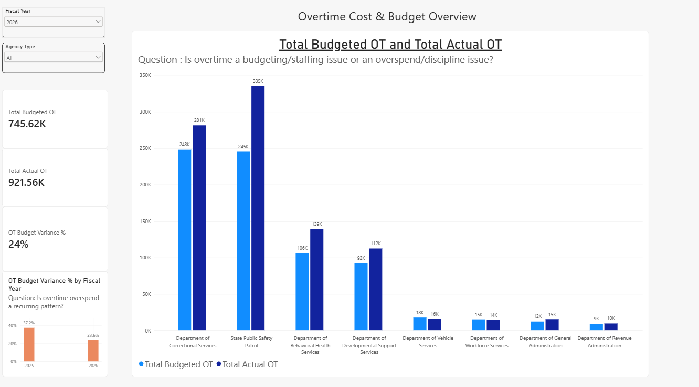
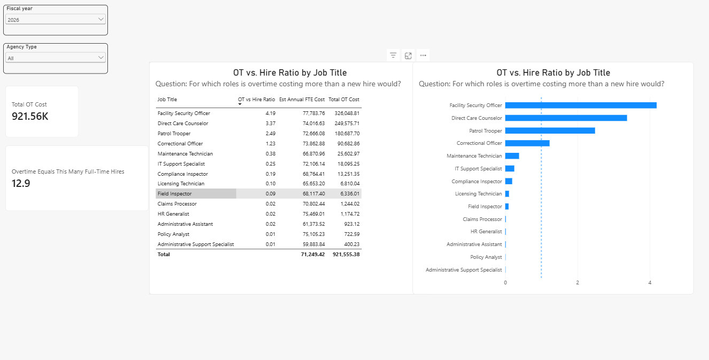
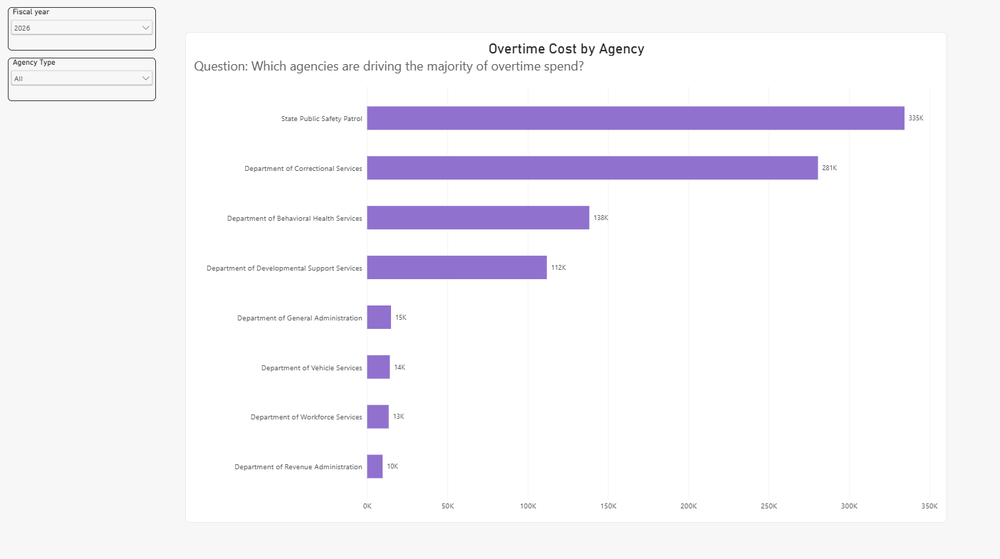
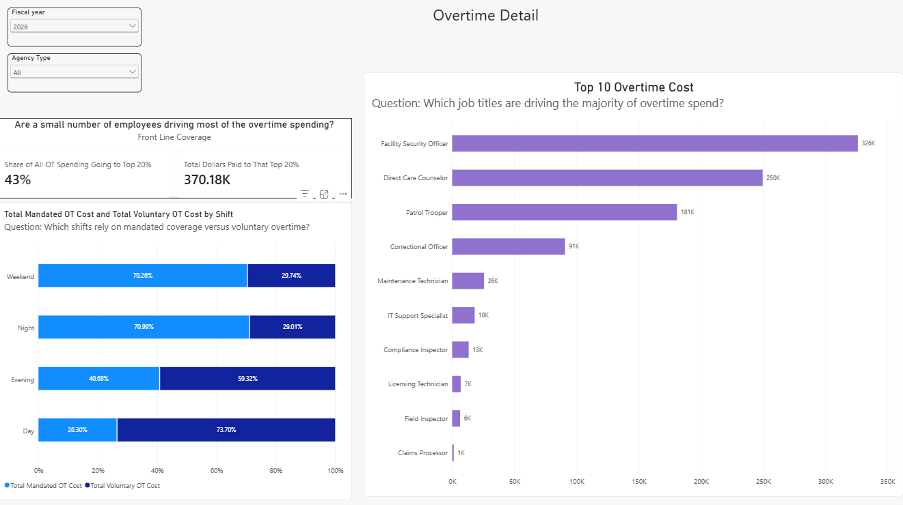
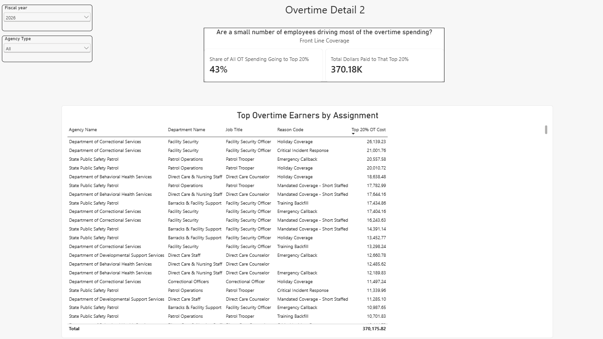
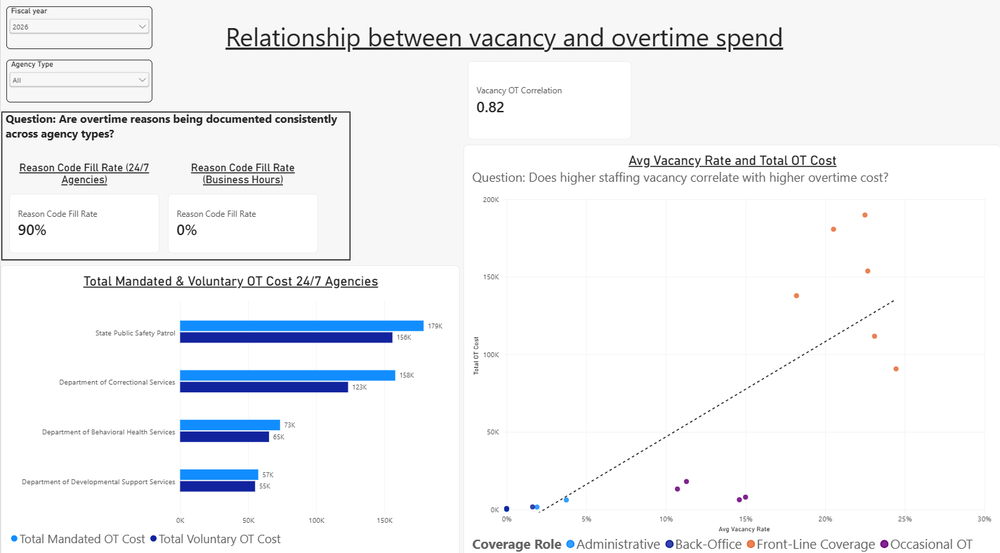
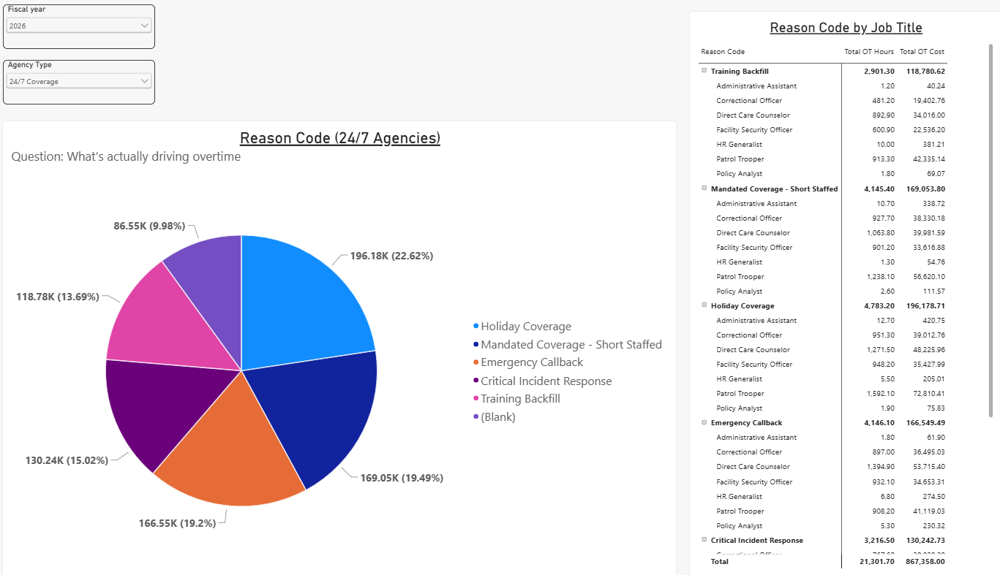
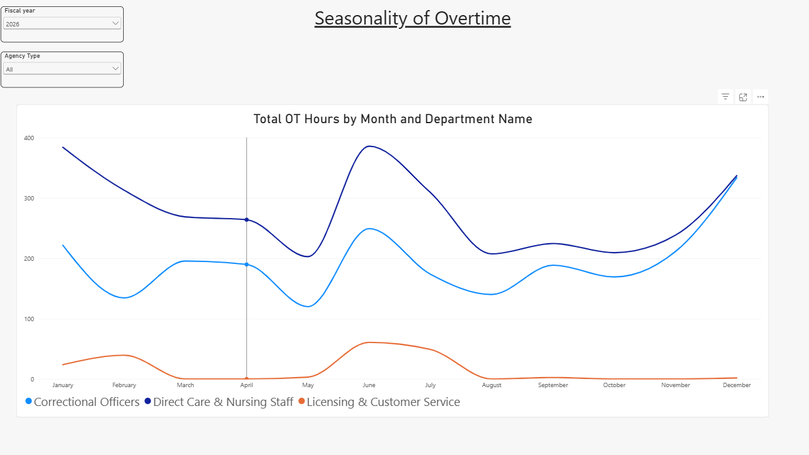

# Statewide Overtime Analysis Dashboard (Power BI)

A multi-page Power BI report I designed and built to show data reconciliation, dashboard design and root-cause analysis, focused on statewide overtime management. It answers the questions managers and financial analysts ask: is overtime a budgeting and staffing problem or an overspend problem, who and what is driving it, and where would hiring cost less than overtime?

**All data is fictional.** Agency names, employee IDs and dollar amounts are randomly generated. No real employee, payroll or agency data is used anywhere in this model. What *is* realistic is the structure: position-level payroll detail, budget-versus-actual tracking, and staffing vacancy data across a mix of 24/7 coverage agencies and standard business-hours agencies.

**[View the full report as a PDF](Practice_Overtime_Dashboard.pdf)** (no Power BI needed) or download the [Power BI file](Practice_Overtime_Dashboard.pbix).

## The Questions Each Page Answers

| Page | Question |
| --- | --- |
| **Cost & Budget Overview** | Is overtime a budgeting/staffing issue or an overspend issue, and has that answer been consistent year over year? |
| **Overtime Cost by Agency** | Which agencies are driving the majority of overtime spend? |
| **Overtime Detail** | Who and what is actually driving the cost: concentration among top earners, by job title, and mandated vs. voluntary by shift |
| **Vacancy and Overtime** | Does staffing vacancy correlate with overtime cost, tested at the individual department level? |
| **Reason Code** | What's documented as driving overtime for 24/7 agencies, and how much goes undocumented? (Business-hours agencies don't record reason codes.) |
| **Seasonality** | Is overtime a predictable seasonal pattern, a chronic year-round pattern, or a sharp short-window spike, and does that differ by department? |
| **Cost Avoidance** | For which job titles would hiring an additional FTE cost less than the overtime already being paid? |

## Highlight: Overtime vs. Hire Ratio

The Cost Avoidance page compares each job title's total overtime cost to the estimated annual cost of one new full-time employee in that role. A ratio above 1.0 means the state is already spending more on overtime than a new hire would cost. In this fictional data, four front-line roles are above that line: Facility Security Officer (4.2), Direct Care Counselor (3.4), Patrol Trooper (2.5) and Correctional Officer (1.2). That points to where hiring could save money. Overall, FY2026 overtime equals the cost of about **12.9 full-time hires**.

## Key Findings (FY2026, fictional data)

- Overtime ran **23.6% over budget** in FY2026, down from **37.2%** in FY2025: overspend is recurring, but improving.
- Four 24/7 agencies drive almost all overtime cost.
- The top 20% of front-line earners account for **43%** of front-line overtime spending.
- Department vacancy rates and overtime cost have a strong positive correlation (**0.82**).
- About **10%** of 24/7 overtime cost has no documented reason code.

## How Key Figures Are Calculated

| Measure | Calculation |
| --- | --- |
| **OT Budget Variance %** | (Total Actual OT - Total Budgeted OT) ÷ Total Budgeted OT |
| **OT Budget Variance % by Fiscal Year** | Same calculation, shown side by side for FY2025 and FY2026 regardless of the slicer, to test whether the variance recurs or was a one-year anomaly |
| **Avg Vacancy Rate** | (Budgeted Positions - Filled Positions) ÷ Budgeted Positions, averaged by quarter and department |
| **Vacancy OT Correlation** | Pearson correlation coefficient between department-level Avg Vacancy Rate and Total OT Cost |
| **Mandated OT %** | Mandated OT Cost ÷ Total OT Cost (24/7 coverage agencies only) |
| **Reason Code Fill Rate** | Rows with a documented reason code ÷ Total OT rows |
| **Top 20% Concentration %** | OT cost from the top 20% of front-line coverage employees ÷ Total front-line coverage OT cost |
| **OT vs. Hire Ratio** | Total OT Cost for a job title ÷ Est. Annual FTE Cost (avg. hourly rate × 2,080 hours × 1.35 fringe factor) |
| **OT Equivalent FTEs** | Total OT Cost ÷ average Est. Annual FTE Cost: how many full-time hires the overtime spend could fund |

## Assumptions

- The 1.35 fringe benefit multiplier is an approximation. A real analysis would use the agency's actual fringe rate.
- The model covers two fiscal years (FY2025 and FY2026) to keep position-level and pay-period-level detail manageable while still showing a real seasonal pattern.

## Screenshots

### Overtime Cost by Agency

### Overtime Detail

### Vacancy and Overtime

### Reason Code

### Seasonality

## How I Built It

- **Power Query:** cleaned and shaped payroll, budget and vacancy data
- **Data model:** connected agencies, departments, job titles, employees, pay periods, shifts, reason codes, budget and positions
- **DAX:** budget variance, vacancy rate, Pearson correlation, concentration analysis, and OT vs. Hire Ratio
- **Slicers:** fiscal year and agency type, applied across pages

## Tools

Power BI Desktop, DAX, Power Query, data modeling, Excel

## About Me

I'm Michelle Leonard, a finance and data professional with 20+ years of experience turning messy multi-system data into reporting that leaders trust and use. LinkedIn: https://www.linkedin.com/in/michelle-leonard-331126b

More of my work: https://github.com/michelleleonard23/higher-ed-financial-dashboard
